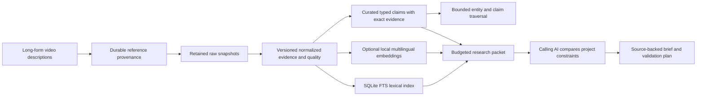

# Evidence-backed technology research library v2

Implementation started 2026-11-02 from `2dfca14`. Canonical outcome: [GOALS.md](GOALS.md). This is the current architecture note; the [2026-11-01 audit](ARCHITECTURE-AUDIT-2026-11-01.md) remains the historical baseline.

## Architecture

The system provides evidence and a repeatable research workflow. An external AI performs interpretation and recommendation. There is no hidden LLM call or claim that a search result alone is a technical decision.

SQLite holds both full-text retrieval and explicit entity/claim tables. A lightweight knowledge graph connects a release/project to capabilities, languages, hardware, licenses and methods only through curated claims. It has no inferred compatibility edges. Graphify is not a required runtime: a code dependency graph does not replace dated document claims and source review.

## Archive and evidence integrity

The first run persists the initial six-month date floor in `data/archive-policy.json`; later runs retain that floor. An existing corpus migrates its prior observed boundary. A new clone seeds its own initial window. Captured sources remain in a durable registry when description links are removed, with current/historical flags and description/parent hashes.

Retained raw snapshots are reprocessed locally before requesting the web again. Normalization classifies research documents separately from listings, service pages and inadequate extraction. Base64/data URI payloads are excluded from derived retrieval text while raw receipts are retained. JSON is treated as data. Every source text version is addressed by a complete SHA-256 digest; changed versions and old Markdown remain available. Citations check both source digest and rendered source body.

Extraction status, source review, cited claim coverage and audiovisual review are separate. Adding one claim creates a partial review entry. A complete review needs explicit ranges covering every nonempty source-text line and an attestation; it is still not independent reproduction of the publisher's claims.

## Retrieval and research

Lexical search uses Unicode normalization, explicit small Indonesian/English aliases, FTS candidates and query-covering windows. This is not general translation. Excerpts include exact unchanged source line/column ranges, even where a data URI or link target is omitted. A giant first line obeys the same character cap as any other line.

Optional multilingual E5-small runs locally on CPU with pinned ONNX weights. Download requires an explicit opt-in; ordinary search does not download a model. Token-aware splitting prevents silent truncation. Vectors are cached by model, mode and text identity. A semantic artifact records the evidence-index hash and becomes explicitly unavailable when stale. Similarity is not factual confidence or hardware compatibility.

The measured default is improved lexical retrieval: it outperformed semantic and hybrid on the full-corpus development set. Semantic retrieval remains optional; the small pilot did not generalize. Explicit auto/hybrid modes combine ranked document streams using reciprocal-rank fusion. Modes and fallback are explicit. A bounded research packet adds curated profiles, stated constraints, supported conditions, absent required fields and original evidence passages. Repeated fact provenance is deduplicated through `evidence_sources`; each fact keeps its exact ranges and a `source_ref`. Its compact serialized JSON has an enforced whole-packet character budget. This differs from `search --max-chars`, which caps each text excerpt.

Date filters explicitly choose video publication or source publication. They never silently substitute one for another. Unknown-date inclusion is explicit. Publication filtering is not a release-date filter. Profiles apply filters to their own evidence; a multi-source claim must retain eligible support for every cited source. Derived document date matches mean at least one dated supporting source, so claim dates still need inspection.

## Efficiency and remaining limits

Unchanged metadata/source snapshots are reused within configured refresh intervals. Index rebuilding is local; embedding rebuilding reuses unchanged vector cache entries. In-process semantic calls reuse a loaded model. Separate CLI processes pay initialization cost again; agent integrations should batch related queries in one process when practical.

The corpus is not exhaustively reviewed. Typed profiles are selected examples, not the complete catalogue of technology facts. Discovery-only pages and access/extraction failures remain gaps. Narration, audio samples and visual demonstrations have not been reviewed. Current prices, access, licensing and deployment recommendations may require a fresh source check.

Measured acceptance and limits belong in [VALIDATION-V2.md](VALIDATION-V2.md). They must distinguish retrieval diagnostics from the manually reviewed research workflow and from a universal quality claim. No automatic schedule is installed.
